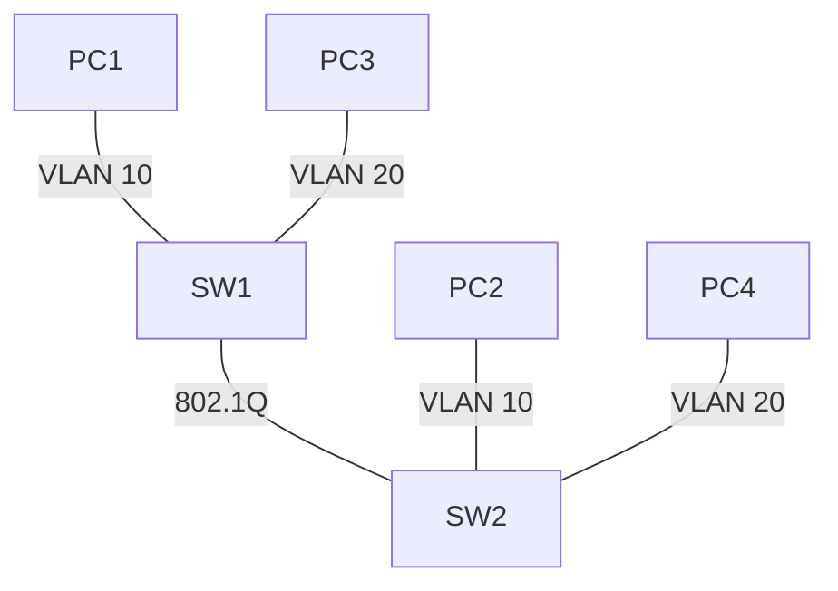

# Topology and addressing

| Node | Suggested image |
| --- | --- |
| SW1 | IOSvL2 switch |
| SW2 | IOSvL2 switch |
| PC1 | VPCS |
| PC2 | VPCS |
| PC3 | VPCS |
| PC4 | VPCS |

## Logical connections

## Exact cabling

| Node A | Port A | Node B | Port B | Segment |
| --- | --- | --- | --- | --- |
| SW1 | GigabitEthernet0/0 | SW2 | GigabitEthernet0/0 | 802.1Q |
| PC1 | eth0 | SW1 | GigabitEthernet0/1 | VLAN 10 |
| PC2 | eth0 | SW2 | GigabitEthernet0/1 | VLAN 10 |
| PC3 | eth0 | SW1 | GigabitEthernet0/2 | VLAN 20 |
| PC4 | eth0 | SW2 | GigabitEthernet0/2 | VLAN 20 |

## Address plan

| Node | Interface | Address | Purpose / gateway |
| --- | --- | --- | --- |
| PC1 | eth0 | 10.10.10.11/24 | same-subnet / DHCP |
| PC2 | eth0 | 10.10.10.12/24 | same-subnet / DHCP |
| PC3 | eth0 | 10.10.20.13/24 | same-subnet / DHCP |
| PC4 | eth0 | 10.10.20.14/24 | same-subnet / DHCP |

Map interface names to the selected image before loading configurations. The cabling table is authoritative.
