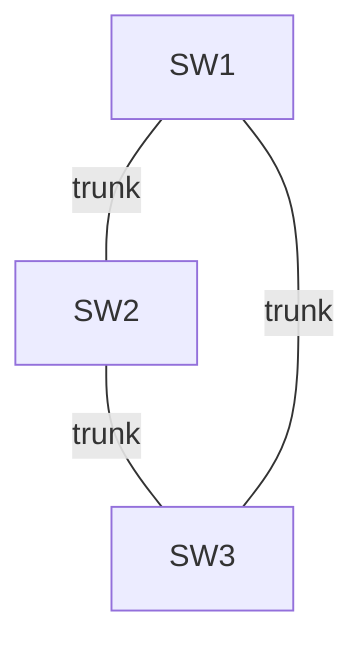

# Topology and addressing

| Node | Suggested image |
| --- | --- |
| SW1 | IOSvL2 switch |
| SW2 | IOSvL2 switch |
| SW3 | IOSvL2 switch |

## Logical connections

## Exact cabling

| Node A | Port A | Node B | Port B | Segment |
| --- | --- | --- | --- | --- |
| SW1 | GigabitEthernet0/0 | SW2 | GigabitEthernet0/0 | trunk |
| SW2 | GigabitEthernet0/1 | SW3 | GigabitEthernet0/0 | trunk |
| SW3 | GigabitEthernet0/1 | SW1 | GigabitEthernet0/1 | trunk |

## Address plan

| Node | Interface | Address | Purpose / gateway |
| --- | --- | --- | --- |

Map interface names to the selected image before loading configurations. The cabling table is authoritative.
