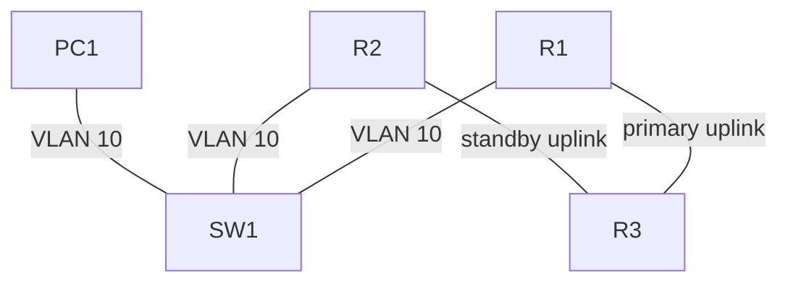

# Topology and addressing

| Node | Suggested image |
| --- | --- |
| SW1 | IOSvL2 switch |
| R1 | IOSv router or compatible IOS XE |
| R2 | IOSv router or compatible IOS XE |
| R3 | IOSv router or compatible IOS XE |
| PC1 | VPCS |

## Logical connections

## Exact cabling

| Node A | Port A | Node B | Port B | Segment |
| --- | --- | --- | --- | --- |
| R1 | GigabitEthernet0/0 | SW1 | GigabitEthernet0/0 | VLAN 10 |
| R2 | GigabitEthernet0/0 | SW1 | GigabitEthernet0/1 | VLAN 10 |
| PC1 | eth0 | SW1 | GigabitEthernet0/2 | VLAN 10 |
| R1 | GigabitEthernet0/1 | R3 | GigabitEthernet0/0 | primary uplink |
| R2 | GigabitEthernet0/1 | R3 | GigabitEthernet0/1 | standby uplink |

## Address plan

| Node | Interface | Address | Purpose / gateway |
| --- | --- | --- | --- |
| PC1 | eth0 | 10.10.10.10/24 | 10.10.10.1 |
| R1 | GigabitEthernet0/0 | 10.10.10.2/24 | physical / logical address |
| R1 | GigabitEthernet0/1 | 10.0.13.1/30 | physical / logical address |
| R1 | GigabitEthernet0/0 | 10.10.10.1 | HSRP virtual IP, group 10 |
| R2 | GigabitEthernet0/0 | 10.10.10.3/24 | physical / logical address |
| R2 | GigabitEthernet0/1 | 10.0.23.1/30 | physical / logical address |
| R2 | GigabitEthernet0/0 | 10.10.10.1 | HSRP virtual IP, group 10 |
| R3 | GigabitEthernet0/0 | 10.0.13.2/30 | physical / logical address |
| R3 | GigabitEthernet0/1 | 10.0.23.2/30 | physical / logical address |
| R3 | Loopback0 | 203.0.113.10/32 | physical / logical address |

Map interface names to the selected image before loading configurations. The cabling table is authoritative.
