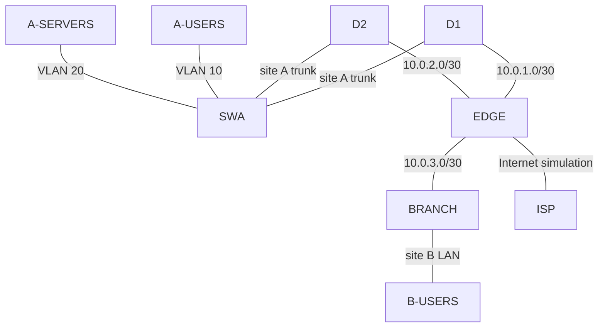

# Topology and addressing

| Node | Suggested image |
| --- | --- |
| SWA | IOSvL2 switch |
| D1 | IOSv router or compatible IOS XE |
| D2 | IOSv router or compatible IOS XE |
| EDGE | IOSv router or compatible IOS XE |
| BRANCH | IOSv router or compatible IOS XE |
| ISP | IOSv router or compatible IOS XE |
| A-USERS | VPCS |
| A-SERVERS | VPCS |
| B-USERS | VPCS |

## Logical connections

## Exact cabling

| Node A | Port A | Node B | Port B | Segment |
| --- | --- | --- | --- | --- |
| D1 | GigabitEthernet0/0 | SWA | GigabitEthernet0/0 | site A trunk |
| D2 | GigabitEthernet0/0 | SWA | GigabitEthernet0/1 | site A trunk |
| A-USERS | eth0 | SWA | GigabitEthernet0/2 | VLAN 10 |
| A-SERVERS | eth0 | SWA | GigabitEthernet0/3 | VLAN 20 |
| D1 | GigabitEthernet0/1 | EDGE | GigabitEthernet0/0 | 10.0.1.0/30 |
| D2 | GigabitEthernet0/1 | EDGE | GigabitEthernet0/1 | 10.0.2.0/30 |
| EDGE | GigabitEthernet0/2 | BRANCH | GigabitEthernet0/0 | 10.0.3.0/30 |
| BRANCH | GigabitEthernet0/1 | B-USERS | eth0 | site B LAN |
| EDGE | GigabitEthernet0/3 | ISP | GigabitEthernet0/0 | Internet simulation |

## Address plan

| Node | Interface | Address | Purpose / gateway |
| --- | --- | --- | --- |
| A-SERVERS | eth0 | 10.1.20.20/24 | 10.1.20.1 |
| A-USERS | eth0 | 10.1.10.10/24 | 10.1.10.1 |
| B-USERS | eth0 | 10.2.30.30/24 | 10.2.30.1 |
| BRANCH | GigabitEthernet0/0 | 10.0.3.2/30 | physical / logical address |
| BRANCH | GigabitEthernet0/1 | 10.2.30.1/24 | physical / logical address |
| D1 | GigabitEthernet0/1 | 10.0.1.1/30 | physical / logical address |
| D1 | GigabitEthernet0/0.10 | 10.1.10.2/24 | physical / logical address |
| D1 | GigabitEthernet0/0.10 | 10.1.10.1 | HSRP virtual IP, group 10 |
| D1 | GigabitEthernet0/0.20 | 10.1.20.2/24 | physical / logical address |
| D1 | GigabitEthernet0/0.20 | 10.1.20.1 | HSRP virtual IP, group 20 |
| D2 | GigabitEthernet0/1 | 10.0.2.1/30 | physical / logical address |
| D2 | GigabitEthernet0/0.10 | 10.1.10.3/24 | physical / logical address |
| D2 | GigabitEthernet0/0.10 | 10.1.10.1 | HSRP virtual IP, group 10 |
| D2 | GigabitEthernet0/0.20 | 10.1.20.3/24 | physical / logical address |
| D2 | GigabitEthernet0/0.20 | 10.1.20.1 | HSRP virtual IP, group 20 |
| EDGE | GigabitEthernet0/0 | 10.0.1.2/30 | physical / logical address |
| EDGE | GigabitEthernet0/1 | 10.0.2.2/30 | physical / logical address |
| EDGE | GigabitEthernet0/2 | 10.0.3.1/30 | physical / logical address |
| EDGE | GigabitEthernet0/3 | 198.51.100.2/30 | physical / logical address |
| ISP | GigabitEthernet0/0 | 198.51.100.1/30 | physical / logical address |
| ISP | Loopback0 | 203.0.113.10/32 | physical / logical address |

Map interface names to the selected image before loading configurations. The cabling table is authoritative.
